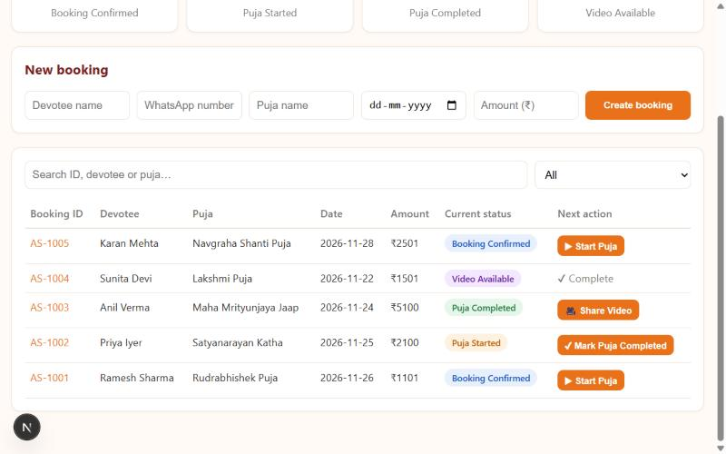
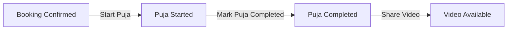

# Aaradhya Setu — Puja Booking Workflow & Notifications

An admin tool that moves each puja booking through four stages and **automatically sends the devotee a WhatsApp message at every stage**.

Built for **Option 3** of the Aaradhya Setu Software Engineering Intern assignment.

**Tech stack:** Next.js 15 · React 19 · Node.js · MongoDB (Mongoose)

▶ **[Watch the 1-minute demo](demo/aaradhya-setu-demo.mp4)**

| Dashboard | Booking workflow & WhatsApp history |
|---|---|
|  |  |

---

## How it works



Each time the admin clicks the next action:

1. The booking moves to its **next stage**. Stages can't be skipped or reversed.
2. A **WhatsApp message** is built from that stage's template, with the devotee's name, puja name and booking ID filled in.
3. The message is **saved in MongoDB** and sent through a mock WhatsApp sender.
4. The page updates to show the new stage and the full **message history**.

## Features

- Dashboard with stage counts, search and filters
- One-click stage updates from the dashboard or the booking page
- Automatic, template-based WhatsApp notifications (mocked)
- Notification history per booking and across all bookings
- Protection against skipped stages, double clicks and duplicate messages
- Responsive layout, sample data and unit tests

## Getting started

**Requirements:** Node.js 18+ and MongoDB running locally (or a MongoDB Atlas URI)

```bash
git clone https://github.com/Prnasin/Aaradhya-setu-workflow.git
cd Aaradhya-setu-workflow
npm install
npm run dev
```

Open **http://localhost:3000** and click **Load sample data**. Run the tests with `npm test`.

> To use MongoDB Atlas, create `.env.local` containing `MONGODB_URI=<your connection string>`.

## Project structure

```
app/            Pages (dashboard, booking detail, notifications) and API routes
lib/
  bookingService.js   Business logic: create, advance, notify
  workflow.js         The four stages, in order
  templates.js        WhatsApp message templates
  whatsapp.js         Mock WhatsApp sender
  models.js           MongoDB schemas
tests/          Unit tests
```

## API

| Method | Endpoint | Purpose |
|---|---|---|
| GET | `/api/bookings` | List bookings |
| POST | `/api/bookings` | Create a booking |
| GET | `/api/bookings/:id` | Booking with its messages |
| POST | `/api/bookings/:id/advance` | Move to the next stage |
| GET | `/api/notifications` | Notification history |

## Key design decisions

- **Forward-only workflow:** the API only offers "advance to next stage", so a stage can never be skipped.
- **Safe concurrent updates:** a booking is updated only if its stage hasn't changed since it was read; otherwise the API returns `409`.
- **No duplicate messages:** a unique database index allows one message per booking per stage.
- **Swappable WhatsApp provider:** all sending goes through one function, so a real API can replace the mock in one file.

## Future improvements

Real WhatsApp API with delivery receipts · admin login · uploading the actual puja video link · a devotee tracking page.

---

<sub>Aparna Singh · Aaradhya Setu SDE Intern assignment</sub>
