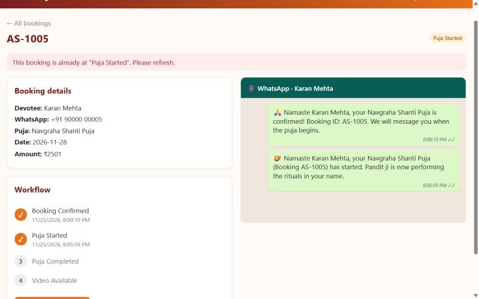
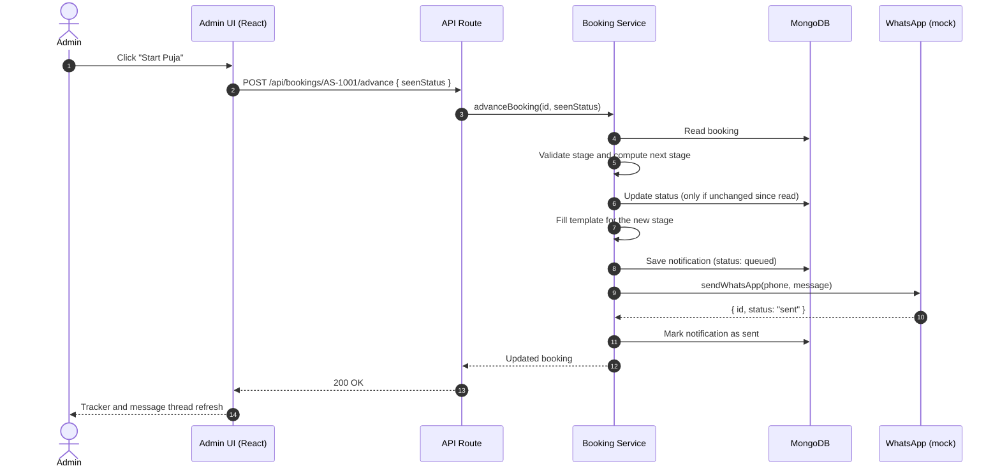
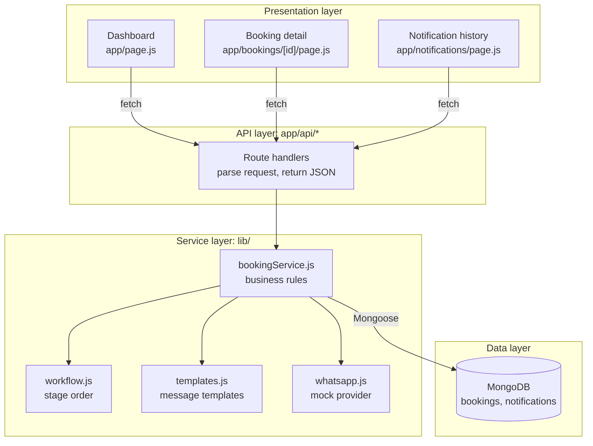

# Aaradhya Setu — Puja Booking Workflow & Notification System

An internal operations tool that moves each puja booking through a fixed four-stage workflow and automatically notifies the devotee on WhatsApp at every stage.

Built as **Option 3 (Full-Stack: Booking Workflow & Notifications)** of the Aaradhya Setu Software Engineering Intern assignment.

**Stack:** Next.js 15 · React 19 · Node.js (Next.js API routes) · MongoDB · Mongoose

---

## Table of Contents

1. [Overview](#1-overview)
2. [Features](#2-features)
3. [Demo](#3-demo)
4. [Workflow](#4-workflow)
5. [Architecture](#5-architecture)
6. [Getting Started](#6-getting-started)
7. [Project Structure](#7-project-structure)
8. [API Reference](#8-api-reference)
9. [Data Model](#9-data-model)
10. [Notification Templates](#10-notification-templates)
11. [Design Decisions](#11-design-decisions)
12. [Testing](#12-testing)
13. [Assumptions and Limitations](#13-assumptions-and-limitations)
14. [Future Enhancements](#14-future-enhancements)

---

## 1. Overview

Devotees book a puja online; the puja is then performed by a pandit at a partner temple. The **operations team** is the link between the two: they track each booking and keep the devotee informed.

This application gives the operations team a single place to:

- see every booking and the stage it has reached,
- advance a booking to its next stage with one click, and
- have the devotee notified automatically, with a full record of every message sent.

| Who | Uses the app? | What they experience |
|---|---|---|
| **Operations admin** | Yes | Dashboard, booking pages, notification history |
| **Devotee** | No | Receives a WhatsApp message at each stage *(mocked in this prototype)* |

---

## 2. Features

| Requirement (Option 3) | Implementation |
|---|---|
| Workflow: Booking Confirmed → Puja Started → Puja Completed → Video Available | Ordered state machine in `lib/workflow.js` |
| Admin interface to move a booking through the workflow | Dashboard and booking detail page, one action button per stage |
| Notifications generated automatically on status change | Every transition triggers `sendNotification()` in the service layer |
| Templates with dynamic devotee name, puja name and booking ID | Per-stage templates with `{{placeholder}}` substitution |
| Notification history saved and displayed | `notifications` collection in MongoDB; WhatsApp-style thread per booking and a global history page |
| Mock WhatsApp notifications | Isolated mock provider in `lib/whatsapp.js` |

**Additional capabilities**

- Search and filter bookings by ID, devotee, puja or stage
- Stage counters on the dashboard
- Protection against skipped stages, concurrent updates and duplicate messages
- Responsive layout for desktop and mobile
- Sample-data loader for demonstrations
- Unit tests using Node's built-in test runner

---

## 3. Demo

**Video walkthrough (1 minute):** [`demo/aaradhya-setu-demo.mp4`](demo/aaradhya-setu-demo.mp4)

| Dashboard | Booking detail: workflow and message history |
|---|---|
|  |  |
| **Notification history** | **Concurrent update rejected** |
|  |  |

All screenshots are in the [`screenshots/`](screenshots) folder.

---

## 4. Workflow

### 4.1 Booking lifecycle

A booking can only move **forward, one stage at a time**. Each transition sends exactly one message to the devotee.

```mermaid
stateDiagram-v2
    direction LR
    [*] --> BookingConfirmed: Booking created
    BookingConfirmed --> PujaStarted: Admin clicks "Start Puja"
    PujaStarted --> PujaCompleted: Admin clicks "Mark Puja Completed"
    PujaCompleted --> VideoAvailable: Admin clicks "Share Video"
    VideoAvailable --> [*]

    BookingConfirmed: Booking Confirmed
    PujaStarted: Puja Started
    PujaCompleted: Puja Completed
    VideoAvailable: Video Available
```



| Stage | Triggered by | Message sent to devotee |
|---|---|---|
| Booking Confirmed | Booking is created | Booking confirmation with booking ID |
| Puja Started | Admin: **▶ Start Puja** | Puja has begun at the temple |
| Puja Completed | Admin: **✔ Mark Puja Completed** | Puja completed; video to follow |
| Video Available | Admin: **🎥 Share Video** | Link to the puja video |

### 4.2 What happens when the admin advances a booking



If the booking has already moved on (for example, another admin advanced it), the service stops at step 5 (or at step 6, if the change happened at the same instant) and returns **409 Conflict**. No status change is made and no message is sent.

---

## 5. Architecture

The application follows a layered design. Each layer has a single responsibility and only talks to the layer below it.



| Layer | Responsibility | Location |
|---|---|---|
| Presentation | Display data and capture admin actions; contains no business rules | `app/**/page.js`, `components/` |
| API | Translate HTTP requests into service calls and errors into status codes | `app/api/**/route.js` |
| Service | Workflow rules, concurrency control, notification generation | `lib/bookingService.js` |
| Domain helpers | Stage order, message templates, messaging provider | `lib/workflow.js`, `lib/templates.js`, `lib/whatsapp.js` |
| Data | Schemas, indexes and the database connection | `lib/models.js`, `lib/db.js` |

---

## 6. Getting Started

### 6.1 Prerequisites

- Node.js 18 or later
- MongoDB: a local installation **or** a free MongoDB Atlas cluster

### 6.2 Installation

```bash
git clone https://github.com/Prnasin/Aaradhya-setu-workflow.git
cd Aaradhya-setu-workflow
npm install
```

### 6.3 Configuration

| Variable | Required | Default |
|---|---|---|
| `MONGODB_URI` | No | `mongodb://127.0.0.1:27017/aaradhya_setu` |

With a local MongoDB, no configuration is needed. To use MongoDB Atlas, create a file named `.env.local` in the project root:

```
MONGODB_URI=mongodb+srv://<user>:<password>@<cluster>.mongodb.net/aaradhya_setu
```

### 6.4 Running the application

```bash
npm run dev
```

1. Open **http://localhost:3000**.
2. Click **Load sample data** to create five bookings at different stages.
3. Open any booking and use the action button to advance it. The mock WhatsApp messages are also printed in the terminal.

### 6.5 Available scripts

| Command | Description |
|---|---|
| `npm run dev` | Start the development server |
| `npm run build` | Create a production build |
| `npm start` | Run the production build |
| `npm test` | Run the unit tests |

---

## 7. Project Structure

```
├── app/
│   ├── page.js                     Dashboard: counters, new-booking form, bookings table
│   ├── bookings/[id]/page.js       Booking detail: workflow tracker and message thread
│   ├── notifications/page.js       Notification history across all bookings
│   ├── layout.js, globals.css      Shared layout and styling
│   └── api/
│       ├── bookings/route.js                 GET list · POST create
│       ├── bookings/[id]/route.js            GET one booking with its notifications
│       ├── bookings/[id]/advance/route.js    POST move to the next stage
│       ├── notifications/route.js            GET notification history
│       └── seed/route.js                     POST load sample data
├── lib/
│   ├── bookingService.js           Business logic (create, advance, notify, seed)
│   ├── workflow.js                 Stage order and action labels
│   ├── templates.js                Message templates and placeholder filling
│   ├── whatsapp.js                 Mock WhatsApp provider
│   ├── models.js                   Mongoose schemas and indexes
│   ├── db.js                       Cached MongoDB connection
│   ├── http.js                     HTTP error helpers
│   └── api.js                      Client-side fetch helper
├── components/StatusBadge.js       Coloured stage badge
├── tests/workflow.test.js          Unit tests
├── screenshots/                    Application screenshots
└── demo/                           Demo video
```

---

## 8. API Reference

| Method | Endpoint | Description | Success |
|---|---|---|---|
| `GET` | `/api/bookings` | List all bookings, newest first | `200` |
| `POST` | `/api/bookings` | Create a booking and send the confirmation message | `201` |
| `GET` | `/api/bookings/:id` | Get one booking and its notifications | `200` |
| `POST` | `/api/bookings/:id/advance` | Move the booking to its next stage and notify the devotee | `200` |
| `GET` | `/api/notifications` | List all notifications, newest first | `200` |
| `POST` | `/api/seed` | Replace all data with sample bookings | `200` |

**Create a booking**

```http
POST /api/bookings
Content-Type: application/json

{ "devoteeName": "Meera Joshi", "phone": "+91 90000 00006",
  "pujaName": "Ganesh Puja", "pujaDate": "2026-11-30", "amount": 1100 }
```

**Advance a booking**

```http
POST /api/bookings/AS-1006/advance
Content-Type: application/json

{ "seenStatus": "Booking Confirmed" }
```

`seenStatus` is the stage the admin was looking at. It is optional; when provided, the request is rejected if the booking has already moved on.

**Error responses** are returned as `{ "error": "<message>" }`:

| Status | Meaning |
|---|---|
| `400` | Missing required fields, or the booking is already at its final stage |
| `404` | Booking not found |
| `409` | The booking was changed by someone else; refresh and try again |
| `500` | Unexpected server or database error |

---

## 9. Data Model

**`bookings` collection**

| Field | Type | Description |
|---|---|---|
| `bookingId` | String, unique | Human-readable ID, e.g. `AS-1001` |
| `devoteeName`, `phone` | String | Devotee details (required) |
| `pujaName`, `pujaDate`, `amount` | String / Number | Booking details |
| `status` | String | Current workflow stage |
| `history` | Array of `{ status, at }` | Timestamp of each stage reached |
| `videoUrl` | String | Set when the booking reaches *Video Available* |
| `createdAt`, `updatedAt` | Date | Managed by Mongoose |

**`notifications` collection**

| Field | Type | Description |
|---|---|---|
| `bookingId`, `devoteeName`, `phone` | String | Recipient and booking reference |
| `status` | String | The stage that triggered the message |
| `message` | String | Final rendered text |
| `channel` | String | `WhatsApp (mock)` |
| `deliveryStatus` | String | `queued` → `sent` |
| `providerMessageId` | String | ID returned by the provider |
| `createdAt` | Date | When the message was generated |

**Index:** `{ bookingId: 1, status: 1 }` is **unique**, so the database itself guarantees at most one message per booking per stage.

---

## 10. Notification Templates

Templates are defined in `lib/templates.js`. Placeholders are written as `{{name}}`.

| Stage | Template |
|---|---|
| Booking Confirmed | 🙏 Namaste `{{devoteeName}}`, your `{{pujaName}}` is confirmed! Booking ID: `{{bookingId}}`. We will message you when the puja begins. |
| Puja Started | 🪔 Namaste `{{devoteeName}}`, your `{{pujaName}}` (Booking `{{bookingId}}`) has started. Pandit ji is now performing the rituals in your name. |
| Puja Completed | ✅ Namaste `{{devoteeName}}`, your `{{pujaName}}` (Booking `{{bookingId}}`) has been completed. Your puja video will be shared shortly. |
| Video Available | 🎥 Namaste `{{devoteeName}}`, the video of your `{{pujaName}}` (Booking `{{bookingId}}`) is ready: `{{videoUrl}}` |

If a placeholder has no value, rendering fails with an error, so an incomplete message is never sent.

---

## 11. Design Decisions

**1. Forward-only state machine.**
Stages are stored as an ordered list, and the API exposes only an *advance* operation, never "set status to X". Skipping or reversing a stage is therefore impossible by design.

**2. Optimistic concurrency control.**
The status update is conditional: `findOneAndUpdate({ bookingId, status: <status just read> })`. If another request changed the booking in between, nothing matches and the API returns `409`. The client also sends the stage it displayed (`seenStatus`), so a click from an outdated browser tab is rejected rather than silently advancing the booking a second time.

**3. Idempotent notifications.**
A unique index on `(bookingId, status)` ensures that, even under retries or race conditions, the database never stores two messages for the same stage. The notification is persisted *before* it is sent.

**4. Safe templating.**
Templates are kept separate from business logic, and rendering fails on any missing value. This mirrors the WhatsApp Business Platform, where business-initiated messages use pre-approved templates.

**5. Pluggable messaging provider.**
All outbound messaging goes through a single function, `sendWhatsApp(phone, message)`. Replacing the mock with a real provider (Meta Cloud API, Twilio, Gupshup) requires changes to that file only.

**6. Thin routes, central service.**
Route handlers only parse input and format output; all rules live in `bookingService.js`. This keeps the logic in one place and makes it reusable (the sample-data loader uses the same functions as the UI).

---

## 12. Testing

```bash
npm test
```

The unit tests in `tests/workflow.test.js` cover:

- stages advance in the correct order,
- no stage exists after *Video Available*,
- an unknown stage is rejected,
- every stage has a template,
- placeholders are filled correctly, and
- a missing placeholder value raises an error.

The full flow has also been verified end to end against a running instance: creation, all four transitions, the final-stage guard, concurrent and outdated requests (`409`), validation (`400`), unknown IDs (`404`) and the absence of duplicate notifications.

---

## 13. Assumptions and Limitations

- **WhatsApp delivery is mocked**, as permitted by the assignment. Messages are stored and displayed, and logged to the server console, but not delivered to a phone.
- **Bookings are created by the admin** in this prototype. In production they would arrive from the customer-facing website after payment, through the same `createBooking()` function.
- **Stages are advanced manually** by the admin, reflecting real-world updates from the temple.
- **The video link is generated** automatically for the final stage; in production the admin would supply the actual link.
- **Authentication is not implemented**, as this is a prototype for local demonstration.

---

## 14. Future Enhancements

- Integrate a real WhatsApp Business API, with delivery and read receipts via webhooks
- Send messages through a background job queue (e.g. BullMQ) with retries and back-off
- Add admin authentication and record which admin performed each transition
- Allow the admin to upload or paste the actual puja video link
- Make templates editable from the interface, and add SMS and email channels
- Provide a devotee-facing page to track a booking and view the video

---

<sub>Prepared by Aparna Singh for the Aaradhya Setu Software Engineering Intern assignment.</sub>
