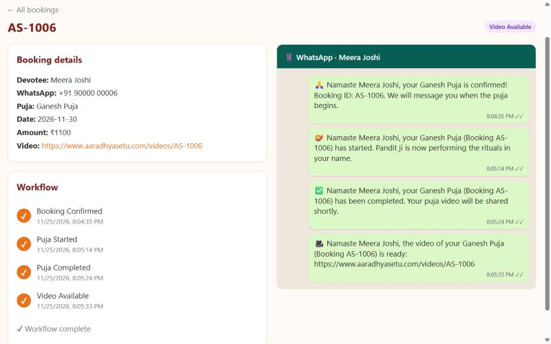
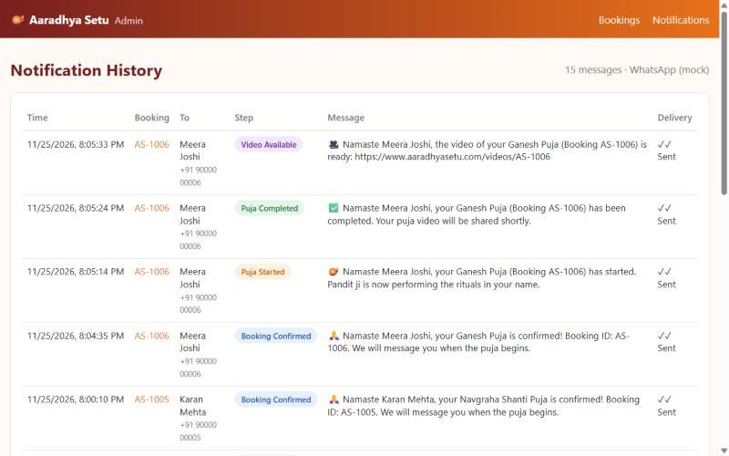

# Aaradhya Setu – Puja Booking Workflow & Notifications

Option 3 of the SDE Intern assignment. An admin moves a puja booking through 4 steps:

```
Booking Confirmed  →  Puja Started  →  Puja Completed  →  Video Available
```

Every time the status changes, a WhatsApp message is **generated automatically** from a template
(with the devotee name, puja name and booking ID), **saved in MongoDB**, and **"sent"** with a mock WhatsApp sender.

**Stack:** Next.js 15 (React) · Next.js API routes (Node.js) · MongoDB + Mongoose · plain CSS

---

## Screenshots

Demo video (1 min): [`demo/aaradhya-setu-demo.mp4`](demo/aaradhya-setu-demo.mp4)

| Dashboard | Booking page: workflow + WhatsApp history |
|---|---|
|  |  |
| **Notification history (saved in MongoDB)** | **Safety check: an outdated click is refused** |
|  |  |

---

## Run it

1. Install **Node.js 18+** and have MongoDB running.
   - **Local MongoDB:** nothing to configure. The app uses `mongodb://127.0.0.1:27017/aaradhya_setu` by default.
   - **MongoDB Atlas:** create a file named `.env.local` in this folder containing
     `MONGODB_URI=mongodb+srv://<user>:<password>@<cluster>.mongodb.net/aaradhya_setu`
2. In this folder:
   ```bash
   npm install
   npm run dev
   ```
3. Open http://localhost:3000 and click **Load sample data**.
4. Run the unit tests: `npm test`

---

## How it works

```
 Admin clicks "→ Puja Started"
        │
        ▼
 POST /api/bookings/AS-1001/advance          (app/api/.../advance/route.js)
        │
        ▼
 advanceBooking()                            (lib/bookingService.js)
   1. find booking
   2. getNextStatus()  → "Puja Started"      (lib/workflow.js)
   3. update booking in MongoDB (only if nobody else changed it)
   4. sendNotification()
        ├─ fillTemplate()  → "Namaste Ramesh, your Rudrabhishek Puja (AS-1001) has started…"  (lib/templates.js)
        ├─ save Notification in MongoDB
        └─ sendWhatsApp()  → mock, logs to the terminal                                       (lib/whatsapp.js)
```

## Folder structure

```
lib/
  workflow.js        the 4 steps + getNextStatus()           ← the "state machine"
  templates.js       message templates + fillTemplate()
  whatsapp.js        mock WhatsApp sender
  bookingService.js  ALL business logic (create, advance, notify, seed)
  models.js          MongoDB schemas: Booking, Notification
  db.js              MongoDB connection (reused)
  http.js            error helpers for the API
  api.js             fetch helper used by the pages
app/
  api/...            thin API routes that call bookingService
  page.js            Dashboard: stats, create form, search/filter table, advance button
  bookings/[id]/     Booking detail: workflow stepper + WhatsApp-style message history
  notifications/     Full notification history
components/
  StatusBadge.js     coloured status pill
tests/
  workflow.test.js   unit tests (Node's built-in test runner)
```

## API

| Method | URL | What it does |
|---|---|---|
| GET  | `/api/bookings` | List all bookings |
| POST | `/api/bookings` | Create a booking → sends "Booking Confirmed" message |
| GET  | `/api/bookings/:id` | One booking + its notifications |
| POST | `/api/bookings/:id/advance` | Move to the next step → sends that step's message |
| GET  | `/api/notifications` | Full notification history |
| POST | `/api/seed` | Reset DB with 5 sample bookings |

Errors come back as `{ "error": "message" }` with a proper status: 400 (bad input / already final step),
404 (not found), 409 (someone else just updated it).

---

## Design decisions (what I'd explain in the review)

**1. Workflow as an ordered list.** `STEPS` is an array, and `getNextStatus()` returns the next item.
The API only has "advance", never "set status to X", so a step can't be skipped or reversed.

**2. Safe against double clicks / two admins / old tabs.** The page sends the step it is showing
(`seenStatus`); if the booking has already moved on, the API returns 409 "Please refresh" instead of moving it again.
The update itself uses `findOneAndUpdate({ bookingId, status: <status I just read> })`, so even two clicks at the
exact same moment can't both succeed. The frontend also disables the button while saving.

**3. No duplicate messages.** The Notification collection has a **unique index on (bookingId, status)**,
so the database itself refuses a second message for the same step. The notification is saved *before* sending.

**4. Templates are separate from code logic.** `fillTemplate()` replaces `{{devoteeName}}` etc. and **throws if a value is missing**,
so a devotee never receives "Namaste {{devoteeName}}". (Real WhatsApp Business also requires pre-approved templates, so this matches how it works in production.)

**5. Mock WhatsApp behind one function.** `sendWhatsApp(phone, message)` is the only place that "talks" to WhatsApp.
To go live, I'd replace that one file with a call to Meta Cloud API / Twilio / Gupshup.

**6. Thin routes, logic in a service.** Routes only parse the request and return JSON; `bookingService.js` holds the rules.
This makes the logic easy to test and reuse (the seed script uses the same functions).

## What I'd add next

- Real WhatsApp API + delivery webhooks (`sent → delivered → read`), with retries for failures
- A queue (e.g. BullMQ) so sending messages doesn't slow down the admin's request
- Admin login and recording *which* admin changed each step
- Editable templates from the UI, and SMS/email channels
- Devotee-facing page to track their own puja and watch the video
